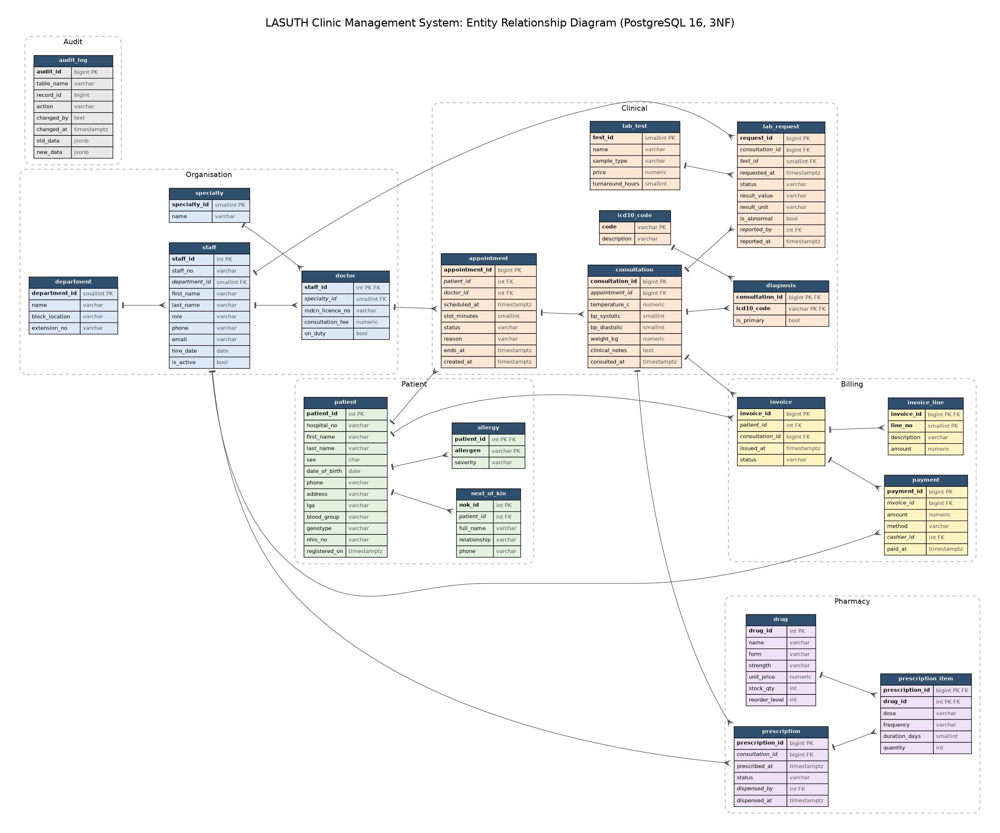

# Portfolio 1: Database Design and Modelling

**Case study:** Lagos State University Teaching Hospital (LASUTH), Ikeja. Outpatient clinics, laboratory, pharmacy and billing.
**Engine:** PostgreSQL 16.15

## Files

| File | Purpose |
|---|---|
| `00_create_database.sql` | Creates the `lasuth` database and fixes the time zone to Africa/Lagos |
| `01_schema.sql` | 20 tables, 2 views, 3 triggers, 4 access roles |
| `02_seed_data.sql` | Departments, specialties, staff, ICD 10 codes, drugs, lab tests and three sample patients |
| `03_constraint_tests.sql` | Deliberately invalid statements that prove each business rule is enforced |
| `er_diagram.png` / `.svg` / `.dot` | ER diagram generated from the live database catalogue, so it cannot drift from the schema |
| `evidence/` | Captured output of every script |

## How it was built and tested

```
psql -U postgres -f 00_create_database.sql
psql -U postgres -d lasuth -v ON_ERROR_STOP=1 -f 01_schema.sql
psql -U postgres -d lasuth -v ON_ERROR_STOP=1 -f 02_seed_data.sql
psql -U postgres -d lasuth -e -f 03_constraint_tests.sql > evidence/03_constraint_tests.log 2>&1
```

## ER diagram



The model has six areas. **Organisation** (department, specialty, staff, doctor), **Patient** (patient, next_of_kin, allergy), **Clinical** (appointment, consultation, diagnosis, icd10_code, lab_test, lab_request), **Pharmacy** (drug, prescription, prescription_item), **Billing** (invoice, invoice_line, payment) and **Audit** (audit_log).

Main cardinalities:

* One patient has many appointments; one appointment produces at most one consultation (enforced by `UNIQUE (appointment_id)` on consultation).
* One consultation has many diagnoses, many lab requests and many prescriptions.
* Prescription and drug are many to many, resolved by `prescription_item`.
* Doctor is a subtype of staff. It shares the staff primary key, so a doctor cannot exist without a staff record, and nurses do not carry empty licence and fee columns.

## Keys and constraints

| Rule from the hospital | How the database enforces it |
|---|---|
| A doctor must never be booked twice for overlapping times | `EXCLUDE USING gist (doctor_id WITH =, tstzrange(scheduled_at, ends_at) WITH &&)` ignoring cancelled and no show slots |
| Drug stock can never go below zero | `CHECK (stock_qty >= 0)` |
| Only one primary diagnosis per visit | Partial unique index on `diagnosis (consultation_id) WHERE is_primary` |
| Diagnoses must use the national coding standard | Foreign key to `icd10_code` |
| A lab result cannot be released without a value and a time | Table level `CHECK` on `lab_request` |
| Genotype and blood group must be valid | `CHECK` lists |
| Card numbers, MDCN licence numbers and NHIS numbers are unique | `UNIQUE` constraints |
| Every change to a diagnosis or lab result is traceable | `fn_audit()` trigger writing old and new rows as JSONB to `audit_log` |
| Cashiers and records officers must not read diagnoses | Role grants in `01_schema.sql` |

Surrogate identity keys are used for every entity because hospital card numbers have changed format over the years; the natural key (`hospital_no`) is kept as a unique alternate key. Composite natural keys are used where the pair itself is the identity: `diagnosis (consultation_id, icd10_code)`, `prescription_item (prescription_id, drug_id)`, `invoice_line (invoice_id, line_no)`.

One design decision worth noting: the first version computed the slot end inside the exclusion constraint as `scheduled_at + make_interval(...)`. PostgreSQL rejected it because adding an interval to a `timestamptz` is only STABLE, not IMMUTABLE, and index expressions must be immutable. The fix was to store `ends_at` and fill it with a `BEFORE INSERT OR UPDATE` trigger. The build log in `evidence/` is from the corrected version.

## Normalisation

The starting point was the paper outpatient card used at the GOPD, which holds everything about a visit on one sheet:

`VisitCard (HospitalNo, PatientName, Sex, DOB, Phone, NOKName, NOKPhone, VisitDate, DoctorName, DoctorSpecialty, DoctorDept, DeptLocation, {Diagnosis1, Diagnosis2}, {DrugName, Strength, Price, Dose, Qty ...}, {TestName, Result ...}, AmountPaid)`

**First Normal Form.** The repeating groups (several diagnoses, several drugs, several tests) were moved into their own relations so every attribute holds one atomic value. A visit is identified by `(HospitalNo, VisitDate, DoctorName)`, which later became the surrogate `appointment_id`.

**Second Normal Form.** In the drug group the key was `(VisitKey, DrugName)`, but `Strength` and `Price` depend only on `DrugName`. That partial dependency produced update anomalies: a price change had to be applied to every past prescription line. Drug attributes moved to `drug`, leaving only `dose, frequency, duration_days, quantity` in `prescription_item`, which depend on the whole key. The same reasoning moved the test name and price into `lab_test`, and the ICD description into `icd10_code`.

**Third Normal Form.** Inside the visit, `DoctorSpecialty` and `DoctorDept` depend on the doctor, not on the visit (VisitKey → Doctor → Specialty is transitive). These moved to `doctor` and `staff`. `DeptLocation` depends on the department, so it lives in `department`. Patient demographics depend only on the patient, so they live in `patient`, and the next of kin moved to its own table because a patient can have more than one.

**Derived values are not stored.** Invoice totals and balances come from `v_invoice_balance`, so a payment can never leave a stored total out of step. The one exception is `appointment.ends_at`, which is derived from `scheduled_at` and `slot_minutes` but has to be stored for the exclusion constraint; the trigger keeps it consistent.

The result satisfies 3NF and, as far as I could check, BCNF: every determinant in each table is a candidate key.

## Evidence

* `evidence/01_schema_build.log` builds without errors
* `evidence/02_seed_load.log` loads without errors
* `evidence/03_constraint_tests.log` shows each invalid action rejected with the expected constraint name
* `evidence/04_table_list.log` lists the 20 tables and the full definition of `appointment`
