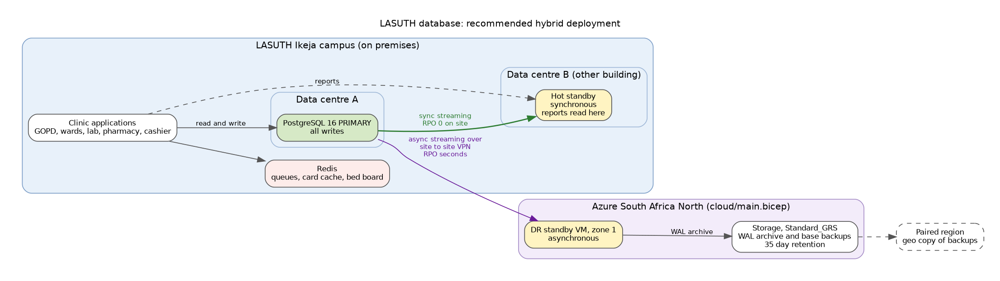

# Portfolio 5: Distributed and Cloud Database Exercise

Three distribution techniques were set up and tested on real PostgreSQL 16 servers running side by side: streaming replication with failover, synchronous replication, and hash sharding across two separate servers. The results were then used to design a hybrid deployment for LASUTH with an Azure disaster recovery site, written as a Bicep template that compiles cleanly.

| Server | Port | Role in the tests |
|---|---|---|
| Primary | 5432 | Main LASUTH database, sharding coordinator |
| Standby | 5433 | Streaming replica, later promoted |
| Shard A | 5434 | Holds the encounters for hash(patient_id) remainder 0 |
| Shard B | 5435 | Holds the encounters for remainder 1 |

## 1. Replication and availability

Set up with `replication/setup_commands.sh` (`pg_basebackup -R -X stream -C -S lasuth_standby_1`), tested with `replication/01_replication_tests.sh` and `replication/02_consistency_and_failover.sh`. The full output is in `evidence/replication_tests.log` and `evidence/consistency_failover.log`.

| Test | Measured result |
|---|---|
| Standby streaming from a physical replication slot | `state = streaming`, 96 bytes behind at the moment of reading |
| Patient registered on the primary | Visible on the standby at the first poll; replay delay 0.077 s |
| Write attempted on the standby | Refused: read only transaction |
| Monthly report run on the standby | Worked, so reporting load can leave the primary |
| Commit cost, asynchronous vs synchronous | 0.50 ms vs 0.58 ms per commit (both servers on one host, so this is the floor; across buildings or zones it grows with network round trip time) |
| Standby stopped while replication is synchronous | The next commit hung in `wait_event = SyncRep`. On cancel, PostgreSQL warned the row had **committed locally but might not have been replicated** |
| Standby restarted | Caught up from the slot to 0 bytes behind, including the row written while it was down |
| Primary crashed (`pg_ctl stop -m immediate`) and standby promoted | Promotion took 0.107 s; the last row written before the crash was present; the new primary accepted writes on timeline 2 |

### Consistency and availability trade off

The standby loss test is the CAP trade off in miniature. In synchronous mode the hospital gets **no data loss** on failover, but when the only synchronous standby disappears, every write stops. A registration desk that cannot register patients is an outage. In asynchronous mode writes never stop, but a crash can lose the last few hundred milliseconds of commits.

For LASUTH my recommendation is quorum commit, `synchronous_standby_names = 'ANY 1 (lasuth_standby_1, lasuth_dr_azure)'`. A commit waits for whichever standby answers first, so losing one standby no longer stops the hospital. Clinical writes keep their zero loss guarantee as long as one copy is reachable.

## 2. Sharding

Files are in `sharding/`, with output in `evidence/sharding_setup.log` and `evidence/sharding_tests.log`. `dist.encounter` on the coordinator is a hash partitioned table whose two partitions are `postgres_fdw` foreign tables on separate servers. The shard key is `patient_id`, chosen because nearly every clinical query is about one patient.

| Test | Result |
|---|---|
| Distribution of 342,177 encounters | Shard A 171,600 rows, 29,910 patients; Shard B 170,577 rows, 29,861 patients |
| Patients split across shards | 0 |
| Folder lookup for patient 25018 | Plan shows **one** Foreign Scan on shard A only (partition pruning) |
| Hospital wide count by diagnosis | Both shards read concurrently (`Async Foreign Scan`), counts combined on the coordinator, 129 ms |
| Visits per patient (grouped by the shard key) | Entire `GROUP BY` pushed down: each shard runs it and returns only results |
| New visit inserted through the coordinator | Routed to shard A automatically |

Two lessons came out of this. First, a shard key works only for queries that use it. The diagnosis report cannot be pruned and must touch every shard, and in PostgreSQL 16 the final count happens on the coordinator. Grouping by the shard key let the whole aggregation run remotely. Second, my first load script used a correlated lookup on `invoice.consultation_id`, which has no index, once per row. It ran for more than five minutes before I stopped it. Rewritten as one grouped join it took 4 seconds. That is the Portfolio 2 lesson again, this time in a distributed setting, where every wasted row also crosses the network.

Sharding is not in the recommended design below. LASUTH's whole database fits comfortably on one server. Sharding adds cross shard transactions, uneven shard growth and harder backups, and it only pays off past what a single well indexed server can handle. The setup here shows how the hospital would scale out if a state wide shared patient record were ever built across all Lagos State hospitals, which is the natural point to shard by patient.

## 3. Cloud deployment design

**Recommendation: hybrid.** The primary stays at LASUTH Ikeja, with a synchronous standby in a second building, and Azure provides disaster recovery.

| Consideration | Why it points to hybrid |
|---|---|
| Connectivity and power | A clinic cannot stop when the internet link drops. With the primary on site, clinical work continues through an outage and Azure simply catches up afterwards from the replication slot. |
| Latency | Every screen in the hospital talks to a server on the campus network, not one thousands of kilometres away. |
| Data protection | Patient health records are sensitive personal data under the Nigeria Data Protection Act 2023. Keeping the primary copy in Lagos keeps control local; the hospital's data protection officer would still need to approve the encrypted offshore DR copy. |
| Region | There is no Azure region in Nigeria. South Africa North is the nearest region with availability zones, and its paired region holds the geo copy of backups. |
| Disaster recovery | Losing the Ikeja campus (fire, flood) loses only seconds of data, because the asynchronous Azure standby can be promoted exactly as tested above. |

`cloud/main.bicep` defines the Azure side: a private virtual network that only accepts PostgreSQL and SSH traffic from the LASUTH address range, a zone pinned standby VM with no public IP and encryption at host, and a geo redundant storage account. That account has no public access, no shared keys and versioning with 35 day retention, so a ransomware attack on the hospital cannot silently delete the backups. The VM writes WAL using its managed identity, not a stored key. The template compiles with `bicep build` and no linter warnings (`evidence/bicep_build.log`, output `cloud/main.json`). **It was not deployed**, because that needs the hospital's subscription, a VPN gateway and approval.

A fully managed option (Azure Database for PostgreSQL Flexible Server with zone redundant high availability) was also considered. It removes patching and failover scripting, but it would put the primary copy in South Africa and make every clinical screen depend on the internet link, which is the wrong trade for a teaching hospital in Lagos.

## Files

| File | Purpose |
|---|---|
| `replication/setup_commands.sh` | How the standby was built |
| `replication/01_replication_tests.sh` | Roles, lag, read only standby, reporting on standby |
| `replication/02_consistency_and_failover.sh` | Sync vs async, standby loss, crash and promotion |
| `sharding/01_shard_node.sql`, `02_coordinator.sql`, `03_shard_tests.sql` | Hash sharding with postgres_fdw |
| `cloud/main.bicep`, `cloud/main.json`, `cloud/cloud_init_standby.yaml` | Azure DR template and compiled ARM output |
| `cloud/architecture.png`, `.dot` | Deployment diagram |
| `evidence/` | All logs |
